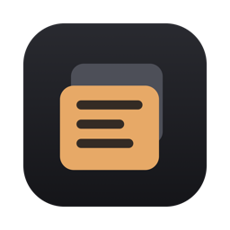
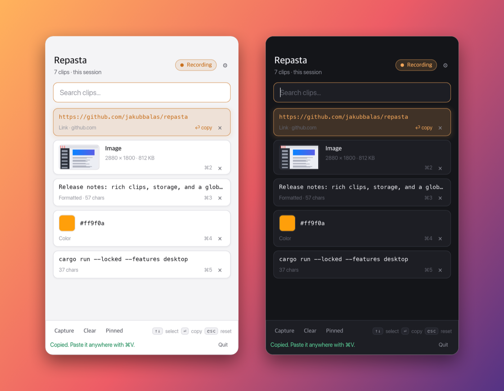
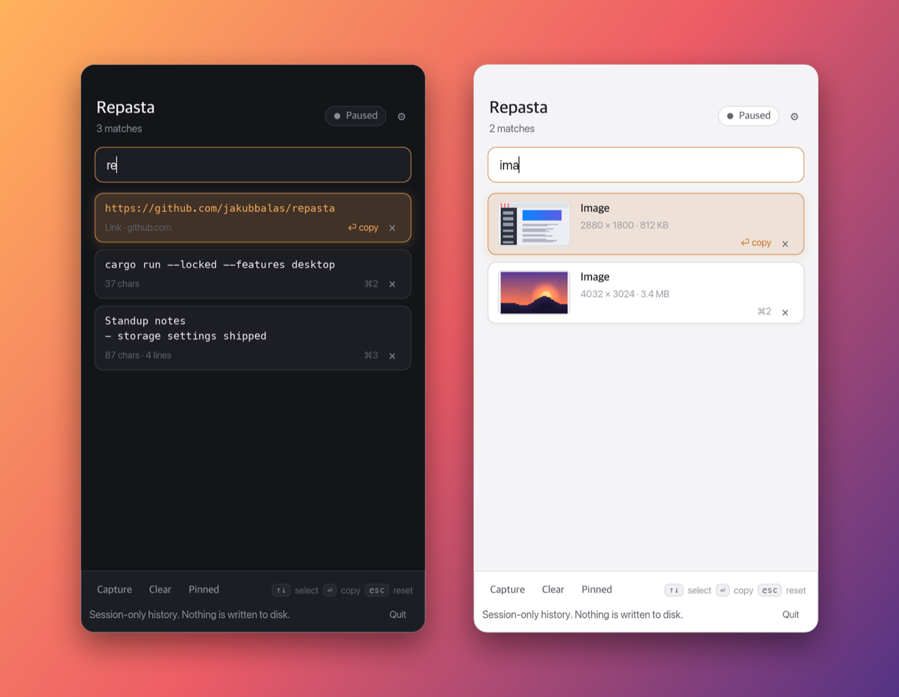
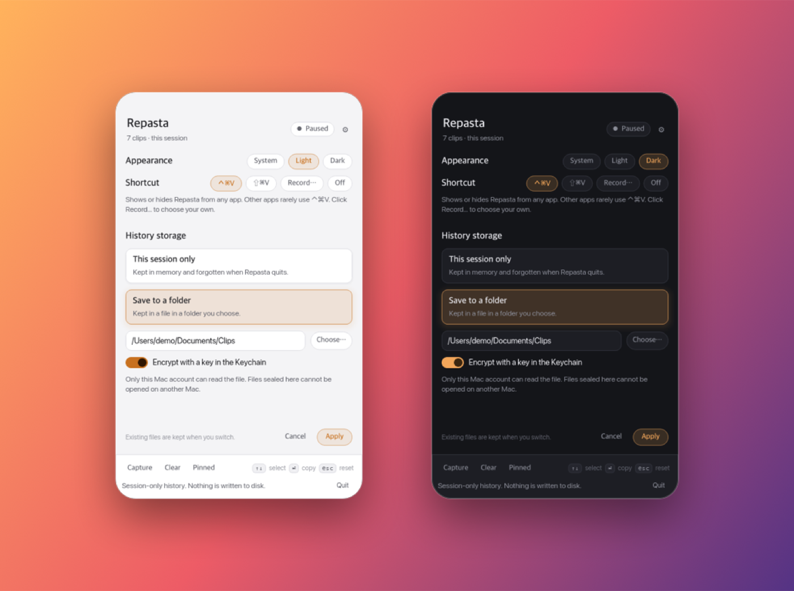

<p align="center">
  
</p>

<h1 align="center">Repasta</h1>

<p align="center">
  <strong>A fast, private clipboard history that lives in your menu bar.</strong><br>
  Copy as usual, press <kbd>⌃</kbd><kbd>⌘</kbd><kbd>V</kbd>, find it, paste it again.
</p>

<p align="center">
  
  
  
  
  
</p>

<p align="center">
  
</p>

> [!NOTE]
> Repasta is an early preview. It's usable day to day on macOS, and Linux
> offers manual capture. Expect rough edges and changes between versions.

## Highlights

- **⌨️ Keyboard first.** Open it from any app with <kbd>⌃</kbd><kbd>⌘</kbd><kbd>V</kbd> (or a shortcut you
  record), type to search,
  <kbd>↑</kbd> <kbd>↓</kbd> to pick, <kbd>⏎</kbd> to copy. <kbd>⌘1</kbd>–<kbd>⌘9</kbd> grab a clip directly.
- **🖼️ More than text.** Screenshots and images with a preview, formatted text
  that keeps its bold and links, and smart cards for links and colors.
- **🔒 Private by default.** History stays in memory unless you choose a
  folder, and saved history is encrypted with a key in your Keychain. No
  network, no account, no telemetry.
- **🤫 Polite about secrets.** Recording is off until you turn it on, and
  items that password managers and other apps mark as sensitive or transient
  are skipped.
- **🌗 Feels native.** A compact floating panel that follows Light or Dark mode
  and your accent color, and hides to the menu bar instead of the Dock.
- **🦀 Small and fast.** Written in Rust, with a bounded history engine and a
  software-rendered UI.

<p align="center">
  
</p>

## Install

### macOS

You'll need [Rust](https://rustup.rs) 1.91 or newer and the Xcode Command Line
Tools (`xcode-select --install`).

```sh
git clone https://github.com/jakubbalas/repasta.git
cd repasta
make install
```

This builds `Repasta.app`, signs it ad hoc for your Mac, and copies it to
`~/Applications`. Open it from Spotlight or Launchpad, and add it to
**System Settings → General → Login Items** to start it with your Mac. Run
`make install` again to update, or `make uninstall` to remove it.

### Linux (preview)

Install GNU Coreutils (`timeout`) and `wl-clipboard` on Wayland or `xclip` on
X11, then:

```sh
make run
```

## Using Repasta

1. Click **Paused** to start **Recording**. The menu bar icon fills in while
   Repasta collects new copies. On Linux, click **Capture** to save the current
   clip.
2. Press <kbd>⌃</kbd><kbd>⌘</kbd><kbd>V</kbd> anywhere to open the panel with an empty search.
3. Type to filter, pick a clip, and press <kbd>⏎</kbd>. It's now on the clipboard;
   paste with <kbd>⌘</kbd><kbd>V</kbd>.

| Keys | Action |
| --- | --- |
| <kbd>⌃</kbd><kbd>⌘</kbd><kbd>V</kbd> | Show or hide Repasta from any app (macOS; change it in settings) |
| Type | Search clips (case-sensitive); type `image` to find images |
| <kbd>↑</kbd> <kbd>↓</kbd> or scroll | Select a clip |
| <kbd>⏎</kbd> or click | Copy the selected clip |
| <kbd>⇧</kbd><kbd>⏎</kbd> or Shift-click | Copy formatted text as plain text |
| <kbd>⌘1</kbd>–<kbd>⌘9</kbd> | Copy clip 1–9 (add <kbd>⇧</kbd> for plain text) |
| <kbd>Esc</kbd> | Clear the search, or close settings |
| <kbd>⌘W</kbd> | Hide the panel; Repasta keeps running in the menu bar |
| <kbd>⌘Q</kbd> | Quit |

On Linux, use <kbd>Ctrl</kbd> in place of <kbd>⌘</kbd>.

More controls:

- **×** on a card deletes that clip. **Clear** deletes all of them, and asks
  first when history is saved to a folder.
- **Pinned** keeps the panel above other windows. Click it to let the panel
  sit behind them instead.
- Click the menu bar icon to show or hide the panel. Right-click it for
  **Show Repasta**, **Hide Repasta**, and **Quit Repasta**.

## What Repasta keeps

| Kind | How it shows | Notes |
| --- | --- | --- |
| Text | Two-line preview with length | Up to 64 KiB per clip |
| Formatted text | Marked **Formatted** | Keeps RTF and HTML (up to 256 KiB each) so bold, links, and styles paste back |
| Images | Thumbnail, dimensions, and size | Screenshots (<kbd>⌃</kbd><kbd>⌘</kbd><kbd>⇧</kbd><kbd>4</kbd>) and copied pictures, up to 10 MiB and 64 megapixels each; restored as PNG and TIFF |
| Links | Link color and host | Display only. Repasta never opens or fetches a link |
| Colors | Swatch | Hex (`#rgb`, `#rrggbb`, with alpha), `rgb()`, `rgba()` |

History holds up to 512 clips, 8 MiB of text, and 128 MiB of images. When a
budget fills, the oldest clips of that kind go first. Copying something that's
already in history moves it back to the top. When a copy holds both text and
an image, Repasta keeps the text. Images and formatting are macOS-only for now.

## Settings

Click **⚙** in the panel.

<p align="center">
  
</p>

- **Appearance:** **System** (default) follows Light and Dark mode as it
  changes; **Light** or **Dark** keeps one. The panel also follows your accent
  color, and keeps Repasta's amber with **Multicolor**.
- **Shortcut:** **⌃⌘V** (default), **⇧⌘V**, one you record, or **Off**. Click
  **Record…** and press the keys you want, holding ⌘, ⌃, or ⌥ (function keys
  work on their own); <kbd>Esc</kbd> cancels. While Repasta runs, its shortcut
  wins over the same keys in other apps, so ⇧⌘V would replace **Paste and Match
  Style**. The shortcut needs no Accessibility permission.
- **History storage:** choose, then click **Apply**.
  - **This session only** (default): clips live in memory and are forgotten
    when Repasta quits.
  - **Save to a folder**: type a path or click **Choose…**. Repasta saves after
    every change.

### How saved history is stored

| | Encrypted (macOS default) | Readable |
| --- | --- | --- |
| File | `repasta-history.sealed` | `repasta-history.txt` |
| Protection | AES-256-GCM with a key created in your login Keychain that never leaves it | None: anything you copy, including passwords, is plain text |
| Opens on | Only this Mac and account | Any text editor (images are inline PNG data) |

Choosing a folder that already has Repasta history adds those clips behind
the current ones. Turning encryption on or off rewrites the file in the new
form. Switching back to **This session only** leaves the file in place. If
the file is damaged, its key is missing, or the folder is unavailable, Repasta
leaves the file alone and keeps history for this session only. Don't point two
running copies of Repasta at the same folder. Linux offers readable files only
for now.

## Privacy

- Nothing leaves your machine. Repasta makes no network requests.
- Recording starts paused. Repasta skips pasteboard items marked as
  concealed, transient, or autogenerated, including password manager items
  that use those markers. Apps that don't mark their items can't be told
  apart, so pause recording when you need to.
- Clip contents never go to logs or diagnostics.
- Every clipboard read is size-limited, and saved files are treated as
  untrusted input when loaded.

## Platform support

| Capability | macOS | Linux |
| --- | --- | --- |
| Background recording | ✅ | Manual **Capture** |
| Text | ✅ | ✅ |
| Formatted text and images | ✅ | Not yet |
| Global shortcut | ✅ | Not yet |
| Menu bar and hide on close | ✅ | Closing the window quits |
| Encrypted saved history | ✅ Keychain | Not yet |
| Light, Dark, and accent color | ✅ | Light and Dark |

On Wayland, capture works only when the compositor allows the clipboard
transfer.

## Development

```sh
make run      # run the desktop app from source
make check    # formatting, Clippy, and tests, with and without the desktop feature
```

| Target | Action |
| --- | --- |
| `make build` | Build the desktop app (release) |
| `make run` | Run the desktop app from source |
| `make app` | Build `target/Repasta.app` without installing (macOS) |
| `make install` | Rebuild and install `Repasta.app` to `~/Applications` (macOS) |
| `make uninstall` | Remove the installed app (macOS) |
| `make fmt` | Format the code |
| `make check` | Run formatting, Clippy, and tests |
| `make clean` | Remove build output |

The history engine is a dependency-free library shared with a small terminal
demo, which reads one clip per line and prints matches newest first:

```sh
printf '%s\n' 'build notes' 'release checklist' 'build notes' |
  cargo run --offline -- search build
```

Contributor guidelines are in [AGENTS.md](AGENTS.md). The roadmap, design
notes, and release criteria are in [PLAN.md](PLAN.md).

## Roadmap

- Paste straight into the front app
- Collections, snippets, and labels
- Images and formatting on Linux, and a Linux global shortcut
- File references and a paste queue
- A remote library adapter for long-term storage

See [PLAN.md](PLAN.md) for the full plan.
